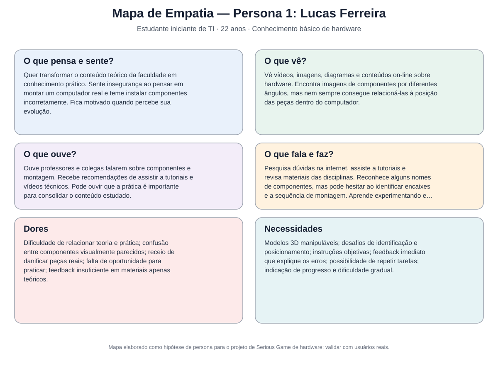

# Entrega 3 — Personas, mapa de empatia, contexto de uso e jornada

**Data:** {08/10/2026}  
**Status:** 🟩 concluída
**Responsabilidade:** 1 persona por integrante; 1 mapa de empatia, 1 contexto de uso consolidado e 1 jornada por equipe (salvo orientação diferente do docente).

## Objetivo da atividade

Representar grupos de usuários de forma útil para decisões de design. Persona não é personagem decorativo: suas características devem alterar requisitos, prioridades, linguagem, fluxos ou critérios de avaliação.

## Atenção a projetos técnicos

Em TCCs sem interface original, a persona pode representar um **profissional que se apropria da contribuição técnica**: DBA, analista, cientista de dados, administrador, pesquisador, técnico, operador, gestor ou especialista de domínio.

Não escolha um perfil apenas porque “parece combinar” com a tecnologia. Explique **qual objetivo esse perfil teria e qual parte da contribuição do TCC produziria valor para ele**. Se ainda for hipótese, mantenha como hipótese/proto-persona a validar.

Também considere papéis diferentes quando houver tarefas distintas, por exemplo:

- operador que executa análises;
- administrador que configura e gerencia permissões;
- especialista que interpreta resultados;
- gestor que consulta relatórios e decide;
- auditor que revisa histórico.

## Entradas da Entrega 1

Antes de criar personas, retome os tipos de usuários, características relevantes, objetivos e hipóteses registradas na Entrega 1. A persona **não deve transformar uma hipótese inicial em fato por meio de uma história fictícia**.

| Item da Entrega 1 | Status inicial | Evidência disponível agora | Como será tratado nesta entrega |
|persona01|conluída|aim|como usuário que irá interagir com o jogo|
| {{usuário}} | F  | incorporar |

## 1. Personas

### Persona P01 — {{Lucas Ferreira - Estudante de Ciência da Computação}}

**Autor(a):** {{Beatriz Cristina Emerenciano — 22.222041-0}}  
**Tipo:** primária 
**Base de evidências:**  observação
**Hipóteses da Entrega 1 relacionadas:** {{H01}}

| Campo | Descrição |
|---|---|
| {{22 anos}} |{{ **Contexto relevante:** Lucas é estudante de Ciência da Computação e possui conhecimentos teóricos básicos sobre componentes de hardware, adquiridos durante a graduação e por meio de pesquisas na internet. Entretanto, possui pouca experiência prática na identificação e montagem de componentes de computadores. Durante os estudos, encontra dificuldades para relacionar os conceitos teóricos às características físicas das peças e compreender seu posicionamento correto. Nesse contexto, utiliza o Serious Game por meio de um navegador web, em seu computador ou smartphone, como recurso complementar de aprendizagem, buscando praticar a montagem virtual, receber feedback sobre suas ações e consolidar os conhecimentos adquiridos.}}  |
| Ocupação/papel | {{estudante universitário da área de TI.}} |
| Conhecimento do domínio | {{reconhece nomes como placa-mãe, memória RAM, processador e SSD, mas apresenta dificuldades para diferenciar modelos, identificar encaixes e entender a sequência de montagem.}} |
| Experiência tecnológica | {{intermediária; utiliza computadores, navegadores e plataformas de aprendizagem diariamente.}} |
| Objetivos | {{Aprender a identificar os componentes internos de um computador, compreender a função de cada peça e sua posição correta, praticar a montagem virtual antes de manipular equipamentos reais, fixar o conteúdo estudado nas disciplinas de arquitetura de computadores e hardware.}}|
| Necessidades | {{Ganhar confiança para realizar uma montagem básica sem depender constantemente de instruções externas.}} |
| Dores/frustrações | {{Conhecer o nome de uma peça não significa saber reconhecer seu formato, seus conectores ou sua posição dentro do gabinete,Tem medo de instalar um componente incorretamente ou danificar uma peça durante uma atividade prática.}} |
| Motivadores | {{anhar confiança para realizar uma montagem básica sem depender constantemente de instruções externas.}} |
| Restrições/acessibilidade | {{Possui conhecimentos básicos de hardware, mas apresenta dificuldades para visualizar os encaixes e compreender o posicionamento dos componentes. Precisa de modelos 3D claros, instruções objetivas, feedback imediato e possibilidade de repetir as tarefas.}} |
| Ambiente típico de uso | {{Utiliza o jogo em casa ou na faculdade, principalmente pelo notebook, durante os estudos ou como complemento às aulas de arquitetura de computadores e hardware.}} |
| Comportamentos relevantes | {{Pesquisa conteúdos técnicos na internet, consulta vídeos e tutoriais, experimenta as atividades propostas e aprende por tentativa e erro. Costuma precisar de orientações para corrigir erros de posicionamento e relacionar os conhecimentos teóricos à prática.}} |

## 2. Personas

### Persona P02 — {{Mariana Oliveira - Estudante de Ciência da Computação}}

**Autor(a):** {{Larissa Fiuza Santos — 22.123.042-8}}  
**Tipo:** primária 
**Base de evidências:**  observação
**Hipóteses da Entrega 1 relacionadas:** {{H01}}

| Campo | Descrição |
|---|---|
| {{35 anos}}| Mariana trabalha na área administrativa e utiliza computadores em suas atividades cotidianas, mas não possui conhecimentos prévios sobre hardware ou montagem de computadores. Ao tentar compreender o funcionamento interno de um computador, encontra dificuldades para identificar os componentes, entender suas funções e compreender os termos técnicos. Busca uma forma simples e interativa de aprender, utilizando o Serious Game por meio de um navegador web, no smartphone ou notebook, sem precisar manipular equipamentos físicos.| {{A ausência de conhecimentos prévios sobre hardware impacta diretamente a compreensão das instruções e a identificação dos componentes. O uso de termos técnicos, interfaces complexas e atividades sem orientação pode gerar confusão e frustração. Por isso, a aplicação deve oferecer linguagem acessível, modelos visuais claros, tutorial passo a passo, feedback explicativo e comandos intuitivos. A compatibilidade com diferentes tamanhos de tela também é importante para permitir o uso tanto em smartphones quanto em computadores.}} |
| Ocupação/papel | {{profissional da área administrativa}} |
| Conhecimento do domínio | {{ensino superior completo em área não relacionada à TI,praticamente inexistente; não sabe diferenciar processador, memória RAM, armazenamento e placa-mãe.}}|
| Experiência tecnológica | {{básica a intermediária; utiliza navegadores, aplicativos e ferramentas de escritório.}} |
| Objetivos | {{Entender quais são os principais componentes de um computador, aprender a função de cada peça utilizando exemplos visuais.Descobrir como os componentes se relacionam dentro do equipamento ,adquirir conhecimentos básicos para conversar com técnicos e tomar decisões mais informadas sobre computadores, aprender de maneira leve, interativa e sem a necessidade de conhecimento técnico anterior.}} |
| Necessidades | {{Tutorial inicial simples, com linguagem acessível e sem pressupor conhecimentos técnicos, modelos 3D acompanhados de nomes, imagens e descrições das funções.Instruções passo a passo, apresentadas conforme a necessidade.Interface intuitiva, com poucos comandos e elementos visuais claros.Feedback acolhedor e explicativo, sem penalizações excessivas por erros.Compatibilidade com navegadores de computador e smartphone.Possibilidade de repetir atividades e consultar explicações sempre que necessário.}} |
| Dores/frustrações | {{Uma interface com muitos comandos, instruções complexas ou erros sem explicação pode desmotivá-la antes mesmo de aprender os conceitos básicos.}} |
| Motivadores | {{Aprender como funciona o hardware de um computador, identificando seus principais componentes e compreendendo suas funções de maneira simples, visual e interativa. Busca adquirir conhecimentos básicos para utilizar a tecnologia com mais autonomia e segurança, sem depender de terceiros ou precisar de conhecimentos técnicos prévios. Sente-se motivada por uma experiência de aprendizagem acessível, intuitiva e gamificada, que permita aprender no próprio ritmo, experimentar e corrigir erros sem medo de danificar equipamentos reais.}} |
| Restrições/acessibilidade | {{Não possui conhecimentos prévios sobre hardware e pode ter dificuldade com termos técnicos e instruções complexas. Precisa de linguagem simples, elementos visuais intuitivos, tutorial guiado, comandos fáceis de compreender e feedback explicativo.}} |
| Ambiente típico de uso | {{Utiliza o jogo em casa, nos horários livres, por meio do navegador do smartphone ou notebook. Prefere acessar a plataforma sem precisar instalar programas ou equipamentos adicionais.}} |
| Comportamentos relevantes | {{relevantes	Utiliza computadores para atividades cotidianas, mas raramente procura conteúdos técnicos sobre seus componentes. Explora o jogo conforme as instruções apresentadas, consulta explicações quando tem dúvidas e pode desistir se encontrar dificuldades sem orientação adequada.}} |

**Decisões de design influenciadas por P01:**

- {{Persona01-  1 Disponibilizar modelos 3D interativos dos componentes, permitindo visualizá-los de diferentes ângulos para facilitar o reconhecimento visual das peças e a compreensão de suas características físicas, 2 Implementar desafios de identificação e posicionamento dos componentes nos locais corretos para permitir que o usuário aplique seus conhecimentos teóricos em atividades práticas de montagem virtual,3 Fornecer feedback imediato após cada ação para ajudar o usuário a compreender seus erros e melhorar o desempenho ao longo das tentativas, indicando acertos e explicando os erros, 4 Apresentar pontuação, progresso e níveis de dificuldade para estimular o engajamento e permitir acompanhar a evolução durante as atividades. }}
- 
- {{ Persona02- 1 Disponibilizar uma etapa inicial de revisão com imagens ou modelos 3D, nomes, funções e descrições dos componentes para Introduzir os conceitos fundamentais sem pressupor conhecimentos prévios, 2 Utilizar linguagem simples, evitando termos técnicos sem explicação para utilizar linguagem simples, evitando termos técnicos sem explicação, 3 Oferecer instruções passo a passo e orientações visuais durante a montagem para Ajudar o usuário a executar as tarefas sem depender de conhecimentos técnicos anteriores, 4 Desenvolver uma interface intuitiva, com comandos claros e adaptação a computadores e smartphones para Facilitar a navegação e permitir o acesso por diferentes dispositivos, 5 Permitir novas tentativas e apresentar mensagens de erro educativas, sem penalizações excessivas para reduzir a frustração e incentivar a aprendizagem por meio da experimentação.

  
> Repita para P02, P03... Cada integrante deve produzir ao menos uma persona.

### Síntese das personas
{{As duas personas apresentam diferentes níveis de conhecimento prévio sobre hardware, o que influencia suas necessidades de aprendizagem e interação com o Serious Game. Lucas, estudante iniciante de TI (Persona 1), possui conhecimentos teóricos básicos, mas apresenta dificuldades para relacionar a teoria à prática, especialmente na identificação e no posicionamento correto dos componentes. Por isso, necessita de atividades interativas, modelos 3D e feedback que o ajude a corrigir erros e consolidar seus conhecimentos.
Mariana, pessoa leiga em hardware (Persona 2), não possui conhecimentos prévios sobre os componentes e suas funções. Suas principais necessidades estão relacionadas à compreensão dos conceitos fundamentais, à utilização de linguagem acessível e à presença de instruções simples e orientações passo a passo. Para esse perfil, a facilidade de uso e a prevenção da frustração são aspectos essenciais.
A Persona 2 — Mariana é definida como prioritária, pois representa o público que apresenta maior necessidade de apoio didático e depende de uma experiência acessível para aprender desde os conceitos básicos. Projetar o jogo considerando suas dificuldades favorece a criação de uma interface intuitiva, com explicações claras e atividades guiadas, que também podem beneficiar Lucas. Para atender à Persona 1, o sistema deve complementar esses recursos com desafios práticos, feedback detalhado e acompanhamento do desempenho.
Dessa forma, o projeto prioriza a acessibilidade didática para iniciantes absolutos, sem deixar de atender estudantes de TI que desejam transformar conhecimentos teóricos em habilidades práticas de montagem virtual.}}

## 2. Mapa de empatia — equipe

**Persona escolhida:** {{P01}}  
**Justificativa:** {{por que esse perfil é relevante}}

Documente também em texto: o que vê; ouve; diz/faz; pensa/sente; dores; ganhos. Diferencie **evidência** de **hipótese**.

## 3. Contexto de uso — consolidação

| Dimensão | Descrição | Implicação de design |
|---|---|---|
| Usuários | {{Estudantes iniciantes de TI, pessoas leigas sem conhecimentos prévios de hardware e, para validação técnica, especialistas da área.}} | {{Utilizar linguagem acessível, apresentar conceitos básicos e oferecer orientações graduais, atendendo a diferentes níveis de conhecimento.}} |

| Tarefas |  {{Consultar informações sobre os componentes, identificar suas características e funções, visualizar modelos 3D, selecionar peças e posicioná-las nos locais corretos durante a montagem virtual.}} |  {{Organizar o jogo em etapas de revisão e montagem, com instruções claras, interação intuitiva e feedback imediato sobre as ações realizadas.}} |

| Equipamentos | {{Computadores, notebooks, tablets ou smartphones com navegador web e acesso à internet}} | {{Desenvolver uma interface responsiva, compatível com diferentes tamanhos de tela e que não exija equipamentos especializados.}} |

| Ambiente físico | {{Ambientes variados, como residências, salas de aula e laboratórios de informática, com diferentes condições de iluminação, ruído e espaço disponível.}} | {{Evitar dependência de condições físicas específicas e permitir a utilização do jogo em diferentes ambientes.}} |

| Ambiente social/organizacional | {{Uso individual para aprendizagem autônoma ou em contexto educacional, como atividade complementar às aulas de arquitetura de computadores e hardware, com possível orientação de professores.}} | {{Permitir que o usuário realize as atividades de forma independente e que o jogo possa ser utilizado como recurso de apoio ao ensino.}} |
| Papéis/permissões/governança | {{Usuários acessam as atividades de aprendizagem; professores ou pesquisadores podem orientar a aplicação e analisar os resultados dos testes. Especialistas podem validar a correção técnica do conteúdo.}} | {{Manter as atividades acessíveis aos participantes e organizar o registro dos resultados de forma adequada, respeitando a privacidade dos dados coletados.}} |

| Volume de dados/histórico | {{O jogo pode registrar respostas, acertos, erros, tentativas, pontuações e progresso nas atividades, além dos resultados de testes de conhecimento antes e depois da utilização.}} | {{Armazenar apenas os dados necessários para acompanhar o progresso e avaliar a aprendizagem, com apresentação clara dos resultados e cuidados com a privacidade.}} |

## 4. Jornada do usuário — equipe

**Persona:** {{P02 - Mariana Oliveira}}  
**Objetivo da jornada:** {{Aprender a identificar os principais componentes de hardware, compreender suas funções e realizar uma montagem virtual básica de computador de forma intuitiva, acessível e sem conhecimentos prévios.}}  
**Início e fim da jornada:** {{Começa quando Mariana percebe que precisa ou deseja aprender sobre hardware e procura uma ferramenta educativa; termina quando conclui a atividade de montagem virtual e recebe feedback sobre seu desempenho.}}

| Etapa | Situação/ação | Objetivo | Pensamento/emoção | Dor | Oportunidade de design | Evidência |
|---|---|---|---|---|---|---|
| 1 Descoberta | {{Mariana percebe que conhece pouco sobre os componentes internos de um computador e procura recursos para aprender.}} | {{Encontrar uma maneira simples de aprender sobre hardware.}} | {{Curiosidade e insegurança: “Por onde eu começo?”}}|{{Dificuldade para encontrar materiais adequados para iniciantes.}} | {{Apresentar o Serious Game como uma ferramenta educativa acessível, com descrição clara de sua finalidade.}} | {{Necessidade identificada no perfil da Persona 2; validar por entrevista ou questionário.}} |
| 2 Acesso ao jogo| {{Acessa a plataforma pelo navegador do celular ou notebook e observa a tela inicial.}} | {{Entender como começar e quais atividades estão disponíveis na tela de menu.}} | {{Expectativa e receio de não saber utilizar o sistema.}} | {{Menus confusos, excesso de informações ou instruções pouco claras.}} | {{Criar uma tela inicial simples, com opções bem identificadas, como “Aprender” e “Iniciar montagem”.}} | {{Necessidade de facilidade de uso identificada no perfil; validar por teste de usabilidade.}} |
| 3 Revisão dos componentes | {{ Na tela de revisão de componentes Acessa a etapa de revisão, visualiza os componentes e consulta suas descrições e funções.}} | {{Reconhecer as peças e compreender para que servem.}} | {{Curiosidade, com possível confusão diante de termos desconhecidos.}} | {{Vocabulário técnico e dificuldade para diferenciar os componentes.}} | {{Utilizar modelos 3D ou imagens, nomes, descrições curtas e linguagem acessível.}} | {{Necessidade de aprendizagem desde o básico; validar a compreensão das explicações.}} |
| 4 Inicio da montagem | {{ Na tela de montagem Inicia o desafio, seleciona um componente e procura identificar onde ele deve ser colocado.}} | {{Aplicar o que aprendeu na etapa de revisão.} | {{Motivação misturada com insegurança: “Será que esta peça vai aqui?”}} | {{Dificuldade de relacionar o formato da peça ao local correto de instalação.}} | {{Destacar visualmente as áreas de posicionamento e oferecer instruções graduais.}} | {{Dificuldade prevista no perfil da persona; observar erros e pedidos de ajuda durante os testes.}} |
| 5 Feedback| {{Na tela de montagem posiciona o componente e recebe uma resposta do jogo indicando se a ação está correta.}} | {{Compreender o resultado da ação e corrigir eventuais erros.}} | {{Satisfação ao acertar ou frustração ao errar sem entender o motivo.}} | {{Feedback genérico ou ausência de explicação sobre o erro.}} | {{Fornecer feedback imediato, explicativo e acolhedor, permitindo novas tentativas.}} | {{Necessidade de orientação e prevenção da frustração; medir erros repetidos e compreensão do feedback.}} |
| 6 Conclusção e avaliação | {{tela de montagem Finaliza a montagem virtual, consulta o resultado e reflete sobre o que aprendeu.}} | {{Verificar seu progresso e consolidar os conhecimentos adquiridos.}} | {{Satisfação por concluir a tarefa e interesse em melhorar.}} | {{Não saber quais conceitos aprendeu ou em quais precisa melhorar.}} | {{Apresentar resumo do desempenho, acertos, erros e sugestões de revisão.}} | {{Avaliar conclusão da tarefa, desempenho e resultados de testes de conhecimento antes e depois da atividade.}} |

> A jornada pode incluir etapas **antes, durante e depois** do uso do produto. Não transforme a jornada em lista de telas.

## Síntese

Quais necessidades e objetivos devem obrigatoriamente aparecer nos cenários e nas tarefas seguintes?
Aprender do zero	Mariana precisa conseguir utilizar o sistema sem conhecer previamente os componentes de um computador.
Identificar os componentes	Ela deve visualizar os componentes e reconhecer seus nomes e características.
Compreender as funções	Precisa entender, em linguagem simples, para que serve cada componente.
Aprender visualmente	Deve poder observar imagens ou modelos 3D que facilitem a identificação e a compreensão das peças.
Montar um computador virtualmente	Deve selecionar componentes e tentar posicioná-los nos locais corretos do ambiente de montagem.
Receber feedback compreensível	Ao acertar ou errar, precisa entender o resultado e, quando necessário, como corrigir a ação.
Aprender sem medo de errar	Deve poder experimentar, cometer erros e tentar novamente sem danificar equipamentos reais.
Utilizar o sistema com facilidade	A interface deve ser intuitiva, com instruções claras e sem exigir conhecimentos técnicos prévios.
Verificar o que aprendeu	Ao final, deve conseguir verificar seu desempenho e identificar o que precisa revisar.

## Checklist

- [x] Existe pelo menos uma persona por integrante.
- [x] As personas não são apenas diferenças demográficas superficiais.
- [x] Está claro o que é dado real e o que é hipótese/proto-persona.
- [x] A persona não “validou por ficção” uma hipótese da Entrega 1; afirmações continuam marcadas como hipótese quando não há evidência.
- [x] Objetivos e dores têm consequência para o design.
- [x] Contexto de uso está coerente com a Entrega 1.
- [ ] Em TCC sem interface original, a persona possui relação explícita com a contribuição técnica.
- [x] Papéis administrativos, técnicos e decisórios só foram criados quando possuem objetivos/tarefas diferentes.
- [x] Jornada possui etapas, dores e oportunidades e não é apenas wireflow.
- [] IDs das personas foram adicionados à rastreabilidade.
